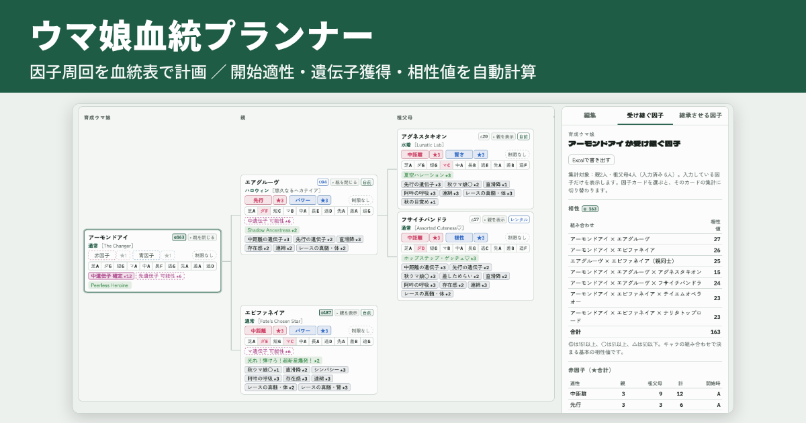

# ウマ娘血統プランナー

ウマ娘プリティーダービーの因子設計を、血統表の形で計画するためのWebツールです。
親・祖父母・曽祖父母に置くキャラと因子を入力すると、育成開始時の適性・遺伝子獲得の可能性・相性値などを自動で計算します。

**▶ ツールを開く：<https://armorkong.github.io/umamusume-factor-planner/>**（ログイン不要・インストール不要）

## できること

* **血統表で因子を組み立てる**：育成ウマ娘から曽祖父母までの枠を最初から用意。「＋ 親を追加」で4代前より先も何代でも追加できます
* **育成開始時の適性を自動計算**：親・祖父母の赤因子の★合計から、芝・ダート・距離・脚質の開始時の適性を表示
* **遺伝子獲得の可能性を表示**：同じ種類の赤因子★が6以上で「可能性」、12以上で「確定」
* **相性値（◎○△）を表示**：育成ウマ娘・親・祖父母の組み合わせから基本の相性値と内訳を計算
* **親子3人で共通の白因子を強調**：自身と両親の3人がそろって持つ白因子を金色、両親だけが共通して持つ白因子を銀色の枠で表示
* **受け継ぐ因子・継承させる因子の★合計**：因子をまとめて集計し、Excelで書き出し
* **スクショから因子を読み取り**：ゲームの継承画面のスクショから、各因子と★の数をまとめて入力
* **因子の更新を見比べる**：今のカードの下に更新後の候補を並べ、見比べてから入れ替え
* **書き出し**：血統表をPDF・画像で保存、全データをJSONでバックアップ
* **スマホ対応**

入力内容はお使いのブラウザの中に自動保存され、サーバーには送られません。

---

## 1. 開き方

|方法|使い方|データの保存先|
|-|-|-|
|Web版（おすすめ）|ブラウザで <https://armorkong.github.io/umamusume-factor-planner/> を開く|開いたブラウザの中（localStorage）。端末ごとに別々に保存されます|
|HTMLファイル版|このリポジトリの `index.html` をダウンロードして、ブラウザで開く|そのブラウザの中（localStorage）。他の端末とは共有されません|

* **iPhone・iPad**：SafariでWeb版のURLを開き、共有ボタン→「ホーム画面に追加」を選ぶと、アプリのようにアイコンから開けます。
* 保存先は端末・ブラウザごとに別です。MacとiPhoneで同じ計画を使いたい場合は、「6. データの保存とバックアップ」の手順でJSONを書き出して、もう一方で読み込んでください。
* 入力したデータは各自のブラウザの中だけに保存され、他の人に見られることはありません。

---

## 2. 画面の構成

* **上部**：使用方法（この説明）／使用例／計画の切り替え／＋ 新しい計画／計画を複製／計画の名前変更・削除／保有キャラ／PDFで書き出す／画像で書き出す／書き出し・読み込み／保存状態の表示
* **表示の行**：白因子を折りたたむ／簡易表示／縮小
* **左（スマホでは中）**：血統表。左端が育成ウマ娘で、右へ親・祖父母・曽祖父母・4代前…と広がります
* **右（スマホでは下）**：「編集」「受け継ぐ因子」「継承させる因子」の3つのタブ

スマホなど画面の狭い端末では、血統表が縦に並ぶ表示に切り替わります。カードの左端の色で世代を見分けられます（育成ウマ娘：緑、親：青、祖父母：橙、曽祖父母：紫、4代前以降：灰）。

### 使用例

* 「使用例」ボタンを押すと、入力済みの計画の例が表示されます。自由に触って試せますが、変更は保存されません。
* 「使用例を閉じる」で一覧から消えます。使用例は保存されないので、ページを開き直したときも一覧から消えます。いつでも「使用例」ボタンで再表示できます。
* 計画が1つもないときは、使用例が表示されます。

### 親を閉じる・表示

* 親がいるカードには「▾ 親を閉じる」ボタンがあり、押すとその先の祖先をたたみます。たたんでいるときは「▸ 親を表示」になり、押すと再び広がります（PC・スマホ共通）。
* PDF・画像の書き出しは、画面と同じく、たたんだ祖先を除いた形で出力されます。

### 白因子を折りたたむ・簡易表示・縮小

* **白因子を折りたたむ**：カードの白因子を「白因子 n種・★合計」の1行にまとめます（親子3人で共通の白因子があるときは「3人共通 n」も表示）。
* **簡易表示**（「表示」の行）：カードを名前・衣装・赤／青因子・遺伝子・白因子の数だけの小さい表示にします。編集パネルはカードを押したときだけ右から重ねて表示し、「✕」かEscキーで閉じます。小さい横長の画面向けです。
* **縮小**（スライダー）：通常表示で、血統表全体を50〜100%に縮めます。簡易表示では、血統表全体が画面に収まる倍率に自動で調整されます（スマホの縦画面を除く）。
* これらの表示の設定は、そのブラウザに記憶されます。

### 血統表をスクロールする

* パソコンで血統表が画面に収まりきらないときは、マウスでつかんでドラッグすると、見える範囲を上下左右にずらせます（カードの上からでも、少し動かすとドラッグになります）。カードの並びが変わることはありません。

---

## 3. 基本の使い方

1. 「＋ 新しい計画」で、曽祖父母までの空の枠を作ります。
2. カードをクリックし、右の「編集」タブで入力します。

   * **キャラ**：名前・愛称・衣装名・固有スキル名の一部を入力すると候補が出ます（例：「ステイゴールド」「ゴルシ」「水着」）。↑↓キーで候補を選んでEnter、またはクリックで決定します。選ぶと基本適性と固有スキル名が自動で入ります。
   * **衣装の愛称**：キャラを選ぶと、名前の下に衣装の愛称（例：水着、秋衣装）が表示されます。欄を書き換えると自分の呼び方に変えられ、空にすると自動の愛称に戻ります。
   * **状態**：自前／レンタル／予定。選んでいるボタンをもう一度押すと解除されます。
   * **メモ**：自由記入。
   * **青因子・赤因子・緑因子**：種類と★を選びます。赤因子の「制限なし」については「4. 自動計算のルール」を参照してください。
   * **遺伝子因子**：「＋ 遺伝子を追加」から。
   * **白因子**：検索欄に因子名を入力し候補から選びます。「まとめて入力する」を開くと「阿吽の呼吸3, 食い下がり2」の形式でまとめて追加できます。血統表のカードでは、入力の方法や順番に関係なく、ゲームの因子一覧と同じ順（レース→スキル→シナリオ→隠し因子）で並びます（一覧にない名前は最後）。
   * **スクショから読み取る**（編集タブの一番上）：ゲームの「ウマ娘詳細」→「継承」タブや「因子一覧」のスクショ（複数枚可。1枚ずつ追加しても前の読み取り結果に足されます）を選ぶと、キャラ（緑因子から判定）と、青／赤／緑／白因子・遺伝子の★の数を読み取り、確認画面で直してからカードに追加できます。確認画面では、スクショの枚数や選んだ順番に関係なく、ゲームの因子一覧と同じ順（青→赤→緑→レース→スキル→シナリオ→遺伝子→隠し因子）に並び、今のカードとの違い（追加・同じ・変更）が表示されます。別のキャラのカードに読み込む場合は、カードの内容（因子・状態・メモ）をすべて消してから読み取り結果で入力し直します（継承元は残ります）。同じキャラの場合は読み取った因子だけを追加・更新します。今の入力と食い違う項目（例：手入力はスピード★2、読み取りは賢さ★2）があるときは、行ごとに「今」か「読取」のどちらを使うか選ぶまで追加できません。読み取り結果にない因子は、チェックを入れたときだけ削除します。画像は端末の中だけで処理し、外部には送りません。初回は文字認識の辞書データ（約16MB）を読み込むため、ネット接続が必要です。読み取り結果は必ずゲーム画面と見比べてください。
3. 赤因子は、血統表のカード上のドロップダウンからも直接選べます。キャラ名が未入力の「未設定」の枠でも選べます。
4. 「受け継ぐ因子」タブで、選んでいるカードが親2人・祖父母4人から受け継ぐ因子の★合計を確認します。
5. 「継承させる因子」タブで、選んでいるカードを親にしたときに子へ渡る因子（自身＋親2人）の★合計を確認します。

### 因子を更新するとき（更新候補）

育成し直した個体など、すでに入力してあるカードの因子を新しくするときに使います。

1. 更新したいカードを選び、編集タブの「操作」にある「更新候補を作る」を押します。
2. 空の「更新候補」のカードが、血統表で今のカードのすぐ下に並びます。更新後のキャラと因子を、手入力かスクショ読み取りで入力します。
3. 候補のカードで「この個体の親（継承元）は、今の血統表の親と同じですか？」に答えます（その枠に親が入力されている場合）。
   * **同じ**：金・銀の枠を、その候補に入れ替えたと仮定して表示します。「この内容で更新」で、今のカードが候補の内容に入れ替わります。
   * **違う**：今の親を前提にした金・銀の枠は意味がないので表示しません。「更新して継承元を空にする」で入れ替えると、その枠より先の祖先は空の枠に戻ります。
4. 今のカードから変わった白因子・遺伝子は、候補のカードで枠で囲んで表示します。やめるときは「候補を消す」を押します。

更新候補は保存され、PDF・画像の書き出しには含まれません。

### 計画を複製する

* 上部の「計画を複製」を押すと、表示中の計画のコピー（「〇〇のコピー」）ができ、そちらに切り替わります。入力内容は自動保存されるので、元の計画を残したまま気軽に組み替えを試したいときに使います。
* 使用例を複製すると、自分の計画として保存できます。

### 枠の操作（編集タブの「操作」）

* **＋ 親を追加**：親が2人未満のとき、枠を追加します（4代前以降も可）。
* **保有キャラに登録／保有キャラから配置**：よく使う因子キャラを、継承元2代分ごと登録・コピーできます。
* **因子を空にする**：キャラ情報だけを消します（継承元は残ります）。
* **この枠と祖先を消す**：
  * 曽祖父母・4代前以降の枠：枠ごと消え、その場所に「＋ 親を追加」が出ます（もう一方の枠の位置は動きません）。祖父母までで使いたいときは、曽祖父母の枠を消してください。
  * 親・祖父母の枠：中身だけ消え、枠の位置は残ります（親1・親2などの並びが変わらないようにするため）。祖父母より先（曽祖父母以降）の枠は取り除かれ、「＋ 親を追加」が出ます。

---

## 4. 自動計算のルール

### 育成開始時の適性

* 対象：そのキャラの親2人＋祖父母4人が持つ、同じ種類の赤因子の★合計
* ★合計が **1・4・7・10** に達するごとに、基本適性が1段階上がります（最大4段階、Aまで）
* 例：ステイゴールド（ダートG・マイルG）の継承元にマイル★7・ダート★3 → 開始時ダートF・マイルD

### 赤因子の選択制限

* 赤因子のドロップダウンには、**育成開始時の適性がA以上**の適性だけが出ます。
* 基本適性がわからないカード（キャラを候補から選んでいない、名前が一覧にないなど）は制限しません。
* 継承イベントなどで開始時より適性が上がり、Aに届いた個体を入力したいときは「制限なし」をオンにすると、すべての赤因子を選べます。開始時の計算でAに届かない赤因子には「⚠」が表示されます。
* 祖先を変えて条件を満たさなくなった赤因子は、消さずに「（B・付きません）」のように表示し、カードの欄が赤い斜線になります。

### 相性

* 親が入力されているカードに、相性の記号と値（例：◎163）を表示します。「受け継ぐ因子」タブで内訳も確認できます。
* 計算に使う組み合わせ：育成×親（2組）、親同士、育成×親×祖父母（4組）の合計です。衣装違いは同じキャラとして扱います。
* 判定：151以上で◎、51以上で○、50以下で△
* キャラどうしの相性ポイントは、ゲームのデータを解析して公開されている値を使っています。
* 親と祖父母が共通して勝ったレースによる加算は含みません。そのため実際のゲームでは、表示より高くなることがあります。
* 育成ウマ娘と親、親どうし、親とその祖父母、祖父母どうしに同じキャラがいる場合は、ゲームでは組めない組み合わせなので、相性値は計算せず「重複」と表示します。

### 遺伝子が付く可能性

* 親2人＋祖父母4人の同じ種類の赤因子★合計が **6〜11で「可能性」、12以上で「確定」** と表示します。

### 親子3人で共通の白因子

* 自身と自分の両親の3人がそろって持っている白因子を、その「自身」のカードだけで金色の枠で表示します（★の数は問いません）。
* 親の側のカードは、その親自身の両親（一つ上の世代）とも共通している場合にだけ金色になります。例：父と祖父母で共通していても、祖父と曽祖父母で共通していなければ、金色になるのは父だけです。
* 「継承させる因子」タブでは、選んでいるカードとその両親の3人に共通する白因子を確認できます。白因子の表でも、共通の因子は金色の枠で表示されます。
* 簡易表示では「共通n」、白因子を折りたたんだ表示では「3人共通 n」と件数で表示します。
* 金色の白因子のうち、組む相手（子のもう一方の親）も持っているものは、光沢のある濃い金（銀の枠・白文字）で表示します。本育成でも因子周回でも有力な因子の目安になります。
* 両親が2人とも持っているのに、その子が持っていない（または子が未設定の）白因子は、両親のカードで銀色の枠で表示します。どちらにも当てはまらない白因子は白で表示します。

### 受け継ぐ因子（集計）

* 選んでいるカードの親2人・祖父母4人のうち、入力済みの分を集計します（何も選んでいないときは育成ウマ娘）。
* 相性の内訳と、入力されている因子だけを表示します（赤因子・遺伝子・青因子・緑因子・白因子の別枠）。赤因子の表には育成開始時の適性も表示します。

### 継承させる因子（集計）

* 選んでいるカードを親として使ったときに子へ渡る因子として、そのカード自身と親2人の分を集計します。
* 親子3人で共通の白因子があれば、一番上に表示します。

---

## 5. 書き出し

|ボタン|内容|
|-|-|
|PDFで書き出す（上部）|表示中の計画の血統表を、血統表の大きさに合わせた1ページのPDFで保存します。ファイル名は計画名です（ネット接続が必要。接続できないときは印刷画面が開きます）|
|画像で書き出す（上部）|表示中の計画の血統表を、枠付きのPNG画像で保存します。ファイル名は計画名です。Mac・Windowsはダウンロードフォルダに保存、iPhone・iPadは画像が表示されるので、画像を長押しして「"写真"に保存」を選ぶか、「ファイルに保存」ボタンを押します|
|Excelで書き出す（受け継ぐ因子タブ・継承させる因子タブ）|選んでいるカードの集計を `計画名_キャラ名_受け継ぐ因子.xlsx`（または `_継承させる因子.xlsx`）で保存します。計★は式なので、編集すると再計算されます|
|書き出し・読み込み（上部）|全データ（使用例を除く）をJSONファイルで保存・復元します（次の章）|

* PDF・画像は、画面の表示をそのまま写すのではなく、書き出し用に描き直しています。白因子が多い大きな血統表でも数秒で作れます。たたんだ祖先は含みません。
* ネットに接続できずPDFを作れないときは、ブラウザの印刷画面が開きます。Macでは印刷画面の左下の「PDF」→「PDFとして保存」を選んでください（この場合は血統表がA4に縮小されます）。
* Excelの作成にはネット接続が必要です（作成用の処理をネットから読み込むため）。
* 書き出したExcel・JSON・画像ファイルは、Macではダウンロードフォルダ、iPhoneでは「ファイル」アプリのダウンロードフォルダに保存されます。

---

## 6. データの保存とバックアップ

* 入力内容は自動で保存されます。上部に「このブラウザに保存」と表示されます。
* 使用例は保存されません。
* 次の場合は、データが消えたり見えなくなったりします。
  * プライベートブラウズで開いた（保存されません）
  * ブラウザの履歴・Webサイトデータを消去した
  * HTMLファイル版で、ファイルの場所や名前を変えた（ブラウザによっては、別のページとして扱われます）
* iPhoneのSafariでは、Webサイトのデータが長期間使われないと自動で削除されることがあります。大事な計画は定期的にJSONで書き出しておいてください。

### 書き出し・読み込みの手順

**書き出す**

1. 「書き出し・読み込み」を開き、次のどちらかを押します。
   * **すべてをJSONファイルに書き出す**：全計画・保有キャラ・設定をまとめて保存します（バックアップ向け）。ファイル名は `ウマ娘血統プランナー_日付_時刻.json` です。
   * **表示中の計画だけ書き出す**：いま表示している計画1つだけを保存します（別の端末へ1つだけ移したいとき向け）。ファイル名は `計画名_日付_時刻.json` です。使用例もこの方法なら書き出せます。
2. ダウンロードフォルダに保存されます。
3. 保存できないときは「テキストで表示」で中身を表示・コピーできます。

**読み込む**

1. 移したい先のページで「書き出し・読み込み」を開く
2. 「ファイルを選択」でJSONを選ぶ（またはテキストを貼り付ける）
3. 次のどちらかを押す
   * **新しい計画として追加**：今の計画は残したまま、ファイルの計画を追加します
   * **すべて置き換える**：今のデータをすべて消して、ファイルの内容に置き換えます

HTMLファイル版で新しい版に差し替えるときは、同じ場所・同じファイル名で上書きし、念のため事前にJSONを書き出しておいてください。Web版は自動で最新版になるので、差し替えは不要です。

---

## 7. オフラインでの利用

* Web版は、ページを開くときにネット接続が必要です。
* HTMLファイル版は、キャラ・衣装データ、白因子の一覧、計算処理がすべてファイルに含まれているため、オフラインでも動きます。
* 画面のフォントはネットから読み込んでいます。オフラインでは端末の標準フォントで表示されます（機能に影響はありません）。
* 画像の書き出しはオフラインでも使えます。PDFとExcelの書き出し、スクショからの読み取りはネット接続が必要です（PDFはオフラインだと印刷画面での保存になります）。

---

## 注意事項

* 非公式のファンツールです。
* アクセス数の把握のため、Web版では Cloudflare Web Analytics を使っています（Cookie は使わず、入力内容は送信されません）。
* 「ウマ娘 プリティーダービー」に関するデータ等の権利は、株式会社Cygamesに帰属します。
